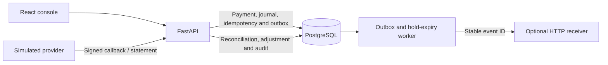

# Proof

**Every cent accounted for.**

Proof is a payment-ledger and reconciliation sandbox. It shows how a backend can
keep its books balanced when clients retry, webhooks arrive out of order, and a
provider reports a different settlement amount. All transfers and providers are fictional.

**Stack** · Python and FastAPI · PostgreSQL and Alembic · React and TypeScript · Docker Compose

## Run the demo

From the project root, with Docker and Docker Compose running:

```bash
docker compose up --build -d --wait
```

Open [the console](http://127.0.0.1:18080/) and select **Run demo**. Compose applies
the database migrations before starting the app. The first build downloads the
base images and dependencies. Only Docker is needed for this path.

1. Compare the **₦25,000** internal transfer with the **₦24,750** provider statement.
2. Select **Review adjustment**, then **Post adjustment**. Proof records the **₦250**
   provider fee in a new balanced journal.
3. Select **Close settlement batch** once the finding is resolved.
4. Open **Ledger explorer** for both journals and **Event trail** for the duplicate
   request, out-of-order callback, statement hash, and operator audit trail.

The browser holds a one-hour demo credential in memory. Reload the page and
start a new scenario to get a fresh session. Run `docker compose stop` to stop
the stack and keep the local database.

| Local endpoint | Use |
| --- | --- |
| [Console](http://127.0.0.1:18080/) | Guided reconciliation and ledger views |
| [Swagger UI](http://127.0.0.1:18080/docs) | Explore the API contract |
| [Readiness](http://127.0.0.1:18080/ready) | Check database connectivity |
| [Grafana](http://127.0.0.1:13001/d/proof-operations) | Request latency, queue health, and open findings with the `observe` profile |

## How it works



- **Ledger.** PostgreSQL enforces balanced, immutable posted journals. Balances
  are derived from integer minor-unit entries. Adjustments and refunds create new journals.
- **Payments.** A payment can move through authorization, submission, and capture.
  Expiring holds and ordered account locks protect available funds. Idempotency keys
  bind to request content and preserve the original command outcome on retry.
- **Reconciliation.** Proof compares the imported statement with internal capture
  records, stores the original evidence, and requires findings to be resolved before
  closing a batch. Signed callbacks are evidence with their own replay protection.
- **Recovery.** Financial changes and outbox records commit together. HTTP delivery
  is at least once. A receiver deduplicates by event ID if the worker crashes after
  delivery but before recording success.
- **Access.** Sandbox sessions are short-lived and isolated per scenario. Operations
  mode uses named, revocable API credentials for integrators, operators, auditors,
  and providers.

## Develop and verify

Run these commands from the project root. The development database is published
on port 55432. The source API listens on port 8000.

```bash
docker compose up -d --wait database
uv sync --frozen
uv run alembic upgrade head
uv run pytest -o addopts="" -q
uv run python scripts/export_openapi.py --check
npm --prefix dashboard ci
npm --prefix dashboard run build
uv run proof-api
```

The source workflow uses Python 3.12+ and Node.js 24. PostgreSQL tests create
and remove their own schema, so use a test or local database role with schema
creation privileges. `uv run pytest` runs the fast API suite alone.

To verify the running Docker demo over HTTP:

```bash
uv run python scripts/smoke_demo.py
```

The check creates one fictional scenario and verifies duplicate evidence, a single
adjustment across retries, both journal totals, the final balance, and batch closure.

For operational checks:

```bash
docker compose --profile observe up -d
docker compose --profile worker up -d
```

The worker expires holds and drains the outbox. Without an HTTP receiver configured,
it uses the local demonstration sink. Retention uses a separate opt-in profile and
should be enabled only on a dedicated demo database.

## Engineering evidence

On a local dataset of 40,000 fictional transfers, the reconciliation candidate
lookup went from 5.663 ms to 0.215 ms median and returned the same results.
The recovery drill restored the ledger checkpoint, applied the latest migration,
and passed the end-to-end settlement scenario.

- [Case study](docs/CASE_STUDY.md) · The incident, design tradeoffs, and test evidence.
- [Architecture](docs/ARCHITECTURE.md) and [decision records](docs/DECISIONS.md) · Boundaries, transactions, and recovery.
- [OpenAPI contract](docs/openapi.json) · Endpoints, request bodies, and response schemas.
- [Threat model](docs/THREAT_MODEL.md) and [runbook](docs/RUNBOOK.md) · Access, evidence, and failure handling.
- [Performance case study](docs/benchmarks/README.md) · PostgreSQL lock sampling and before-and-after query plans.
- [Recovery drill](docs/RECOVERY.md) · Database outage, backup restore, and migration over existing records.
- [Deployment guide](docs/DEPLOYMENT.md) and [roadmap](docs/ROADMAP.md) · Configuration and remaining hosted checks.

## Release scope

The guided sandbox and local monitoring stack are runnable today. The Render
Free Blueprint and Neon setup are documented. The packaged service passed the
local deployment and recovery drill. Public hosting, a live external receiver,
and a hosted trace collector still need verification in the target environment.

[MIT license](LICENSE)
